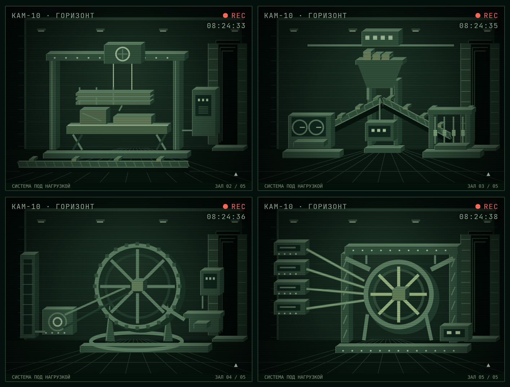

# Камеры остальных четырёх залов

Залы II–V перерисованы в той же графической системе, что первая приёмная галерея: логическая сцена 480×360, металлические объёмные корпуса, стены с глубиной, пол, рабочий свет и дальний проход. Кадр занимает всю ширину и имеет пропорции 4:3; пиксельная детализация сохраняется на экране телефона.

| Зал | Основной силуэт | Изменение при строительстве |
| --- | --- | --- |
| II | Портальный подъёмник, платформа и большой верхний привод | Опоры → подъёмный стол → силовой шкаф → лебёдка. Крупные узлы показывают пакет балок, точные — приборную рейку и головки |
| III | Бункер-разветвитель и две наклонные линии | Общий бункер → дробильный участок слева и приводная линия справа → верхняя шина. Диспетчер появляется только после покупки |
| IV | Большой зубчатый маховик на литом основании | Кольцевой фундамент → обод и спицы → боковой двигатель → стопор. Отдельно видны накопитель и установленный регулятор |
| V | Центральное сопряжение с четырьмя входящими магистралями | Основание → обе несущие рамы → верхняя направляющая → центральный механизм. При испытании видны подача, привод и два индикатора |

Работы читаются из настоящего `work/nodeCost`; пройденные залы показываются полностью построенными. Числа и условия сборки не менялись. Поток на ветвях учитывает фактические доли подачи. Маховик начинает работать после установки нужных частей; накопитель показывает реальный заряд. При уменьшенном движении декоративные перемещения отключены. Нового хранилища состояния или миграции нет.

Осмотр нажатием привязан к физическим областям машин, а не к старым местам значков. Камера не покупает узлы и не меняет очередь. По умолчанию подсвечивается текущая работа; отдельная подсветка готовой машины появляется при явном осмотре. Архивные камеры используют тот же новый рендер.

Рендер — `src/ui/horizonWorksCam.ts`; адаптация камеры, выбор областей и анимация открытия — `src/ui/horizonCam.ts`. Первый зал сохраняет `drawLab`.

## Готовые помещения

Снимки полностью построенных залов из того же игрового рендера, в тестовом сохранении с открытыми камерами:

