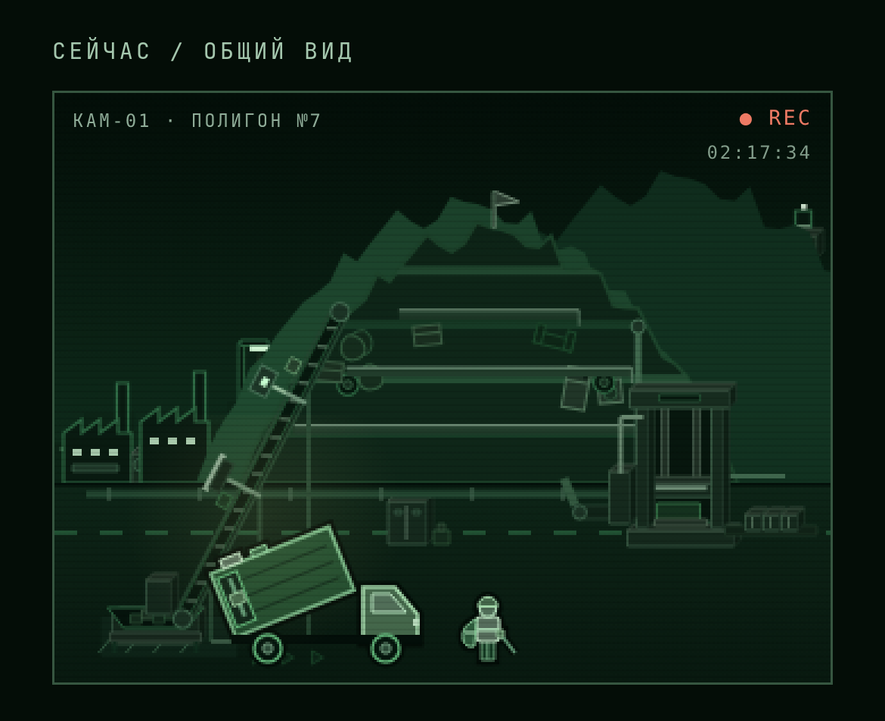
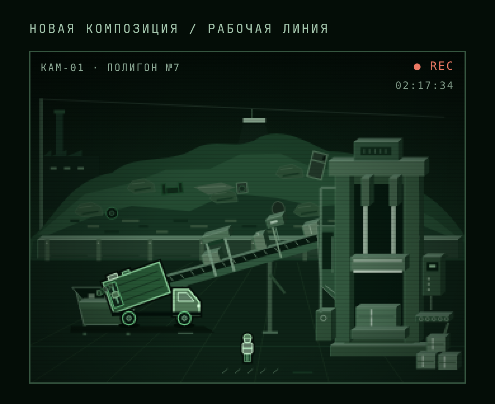

# КАМ-01: рабочая линия крупным планом

Новый композиционный макет построен вокруг переработки материала, с сохранением ночной зелёной графики и существующих игровых объектов. Покупки и стадия производства одинаковы в обоих кадрах. Главный игровой сайт не менялся.

## Сейчас

Большая куча занимает центр, сравнительно мелкие машины распределены по двору.

## Предлагаемый кадр

Камера приближена к рабочей линии. Длинная широкая лента объединяет приёмник и пресс. Гидравлическая машина, её два цилиндра, загрузочная камера и готовые брикеты читаются крупно. Мусорная масса находится за подпорной стеной на дальнем плане, с плавным силуэтом и встроенным в неё хламом. Передний план освобождён от мелких зданий и множества персонажей.

Это статический макет композиции, выполненный кодом в графической системе игры. Мусоровоз, рабочий и предметы мусора используют существующий рендер, лента и пресс нарисованы заново для выбранного масштаба. Подключение новых размеров к игровым анимациям, всем покупкам, событиям и сохранённой инфраструктуре требует реализации после выбора направления. Исходная временная программа: `/workspace/scratch/yard-layouts/close.cjs`.
