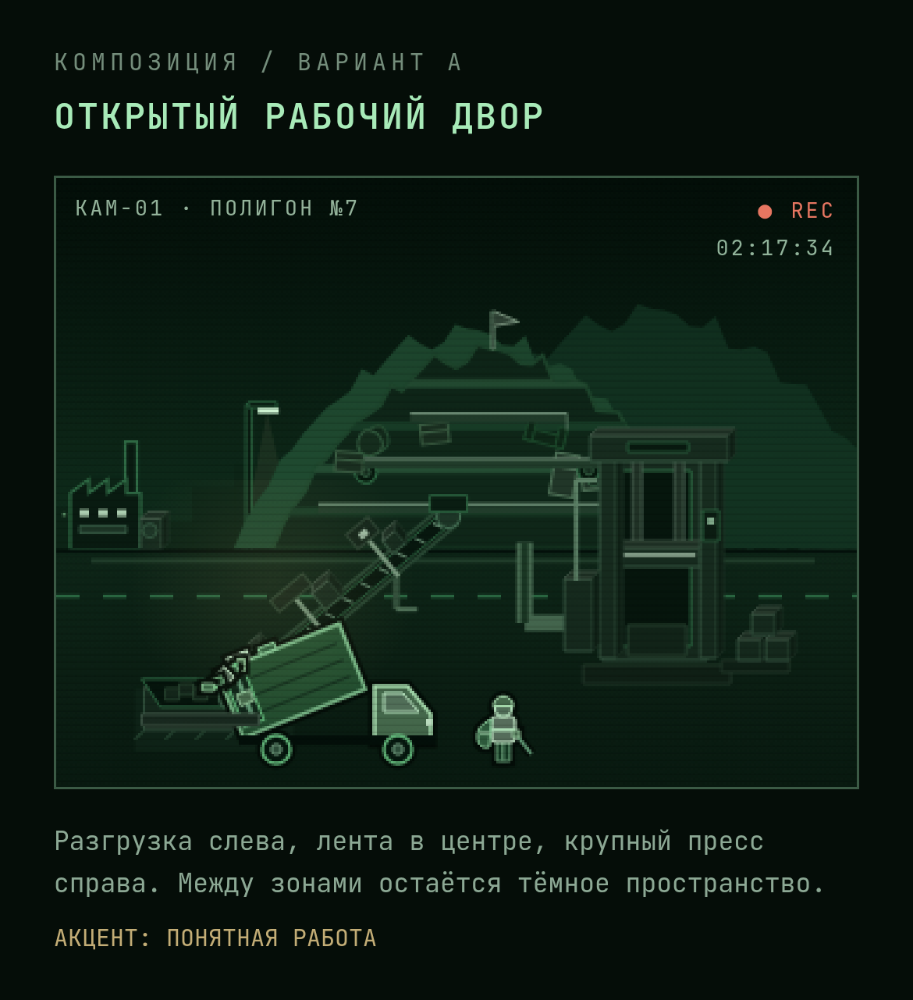
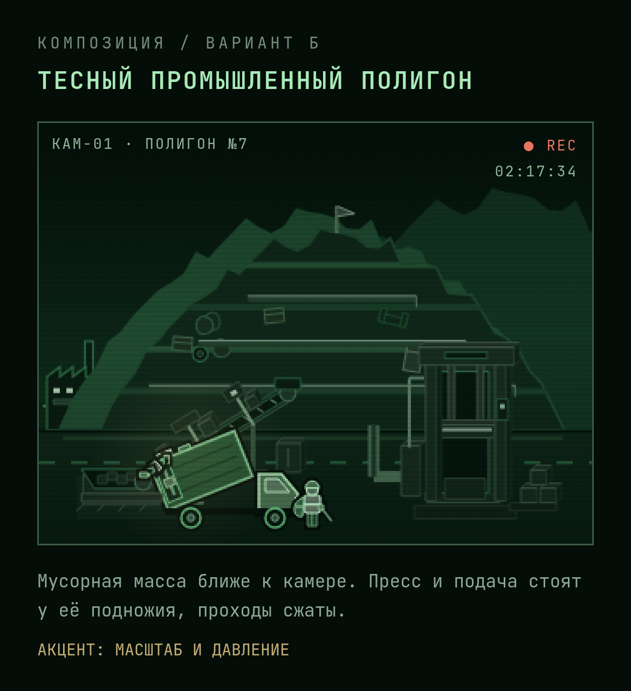

# Два варианта композиции КАМ-01

Макеты одной промышленной стадии из настоящего игрового рендера. Одинаковые покупки, освещение и момент разгрузки. Главный игровой сайт не изменён.

## А — открытый рабочий двор

Разделены разгрузка слева, подающая лента и крупный пресс справа. Есть свободные тёмные участки, здания остаются на дальнем плане. Акцент — читаемая работа предприятия.

## Б — тесный промышленный полигон

Куча приближена и занимает больше кадра. Оборудование собрано у её подножия. Акцент — масштаб мусорной массы и ощущение давления.

Предпочтительное направление: А как основа с постепенным приближением и ростом массы полигона по мере развития. Память инфраструктуры и следов событий после сброса сохраняется в обоих направлениях.

Это статические композиционные эскизы. Новая геометрия не подключена к игре; полный цикл анимации, все этапы покупок и взаимодействие с событиями нужно проверить при переносе выбранного варианта. Снимки проверены на ширине 390px. Исходные временные файлы находятся вне основного репозитория; эта ветка содержит только изображения и описание для просмотра.
